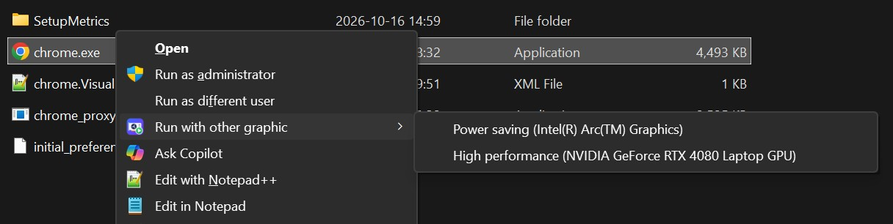
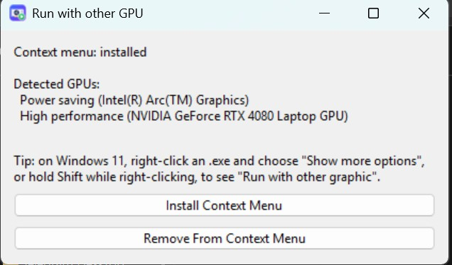

#  run-with-other-gpu

[](https://github.com/amir9480/run-with-other-gpu/releases/latest)
[](https://github.com/amir9480/run-with-other-gpu/releases)
[](https://github.com/amir9480/run-with-other-gpu/actions/workflows/release.yml)

[](LICENSE)

**[⬇ Download the latest release](https://github.com/amir9480/run-with-other-gpu/releases/latest)**

Run any app on the graphics card you choose, just this once, straight from the
right-click menu.

On a laptop with two GPUs, right-click an `.exe` and pick
**Run with other graphic** › **High performance** (your dedicated GPU) or
**Power saving** (your integrated GPU). The app starts on that GPU, and when you
close it, your normal graphics settings come back on their own.



## Install

1. Download `run-with-other-gpu.exe` from the
   [releases page](https://github.com/amir9480/run-with-other-gpu/releases/latest).
2. Run it and click **Install Context Menu**. No admin rights are needed.



The app needs the
[Microsoft Visual C++ Redistributable (x64)](https://aka.ms/vs/17/release/vc_redist.x64.exe),
which most PCs already have. If yours doesn't, the app shows this download link
when you start it.

## Use

Right-click any `.exe` file and choose
**Run with other graphic**, then the GPU you want.

On Windows 11, the entry is in the classic menu. Choose **Show more options**,
or hold **Shift** while you right-click.

## Uninstall

Run `run-with-other-gpu.exe` again and click **Remove From Context Menu**.

## Command line

```
run-with-other-gpu.exe --install
run-with-other-gpu.exe --remove
run-with-other-gpu.exe --run high-performance "C:\Path\To\App.exe"
run-with-other-gpu.exe --run power-saving "C:\Path\To\App.exe"
```

`--run` also works in your own shortcuts.

## Good to know

- **Added a GPU or updated drivers?** Click **Install Context Menu** again to
  refresh the GPU names in the menu.
- **Apps you've never set a GPU for** run on power saving by default, which
  matches Windows' "Let Windows decide".
- **If you change the app's GPU in Windows Settings while it's running**, your
  change is kept.
- **Apps that need admin rights** start after the usual Windows prompt.
- **Some apps choose their GPU themselves** and may ignore the Windows setting.

## How it works

The tool uses the same per-app setting as **Settings › Display › Graphics**
(`HKCU\Software\Microsoft\DirectX\UserGpuPreferences`).

1. If the app is already set to the GPU you picked, the tool just launches it.
2. Otherwise, it saves the app's current setting to
   `%LOCALAPPDATA%\RunWithOtherGpu\state.json`, switches it to the chosen GPU,
   and launches the app.
3. A hidden background process waits until the app and any processes it
   started have exited, then restores the saved setting.

If that background process is interrupted, for example by a crash or a
shutdown, the next start of the tool restores the setting from `state.json`.

## License

[MIT](LICENSE)
